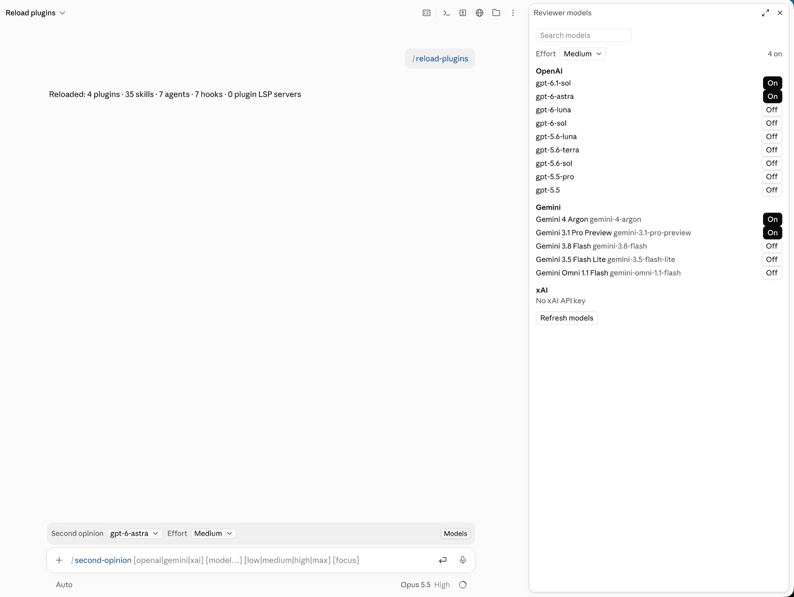

# second-opinion

A Claude Code mod that asks other vendors' models (OpenAI, Gemini and xAI Grok)
to check Claude's work, then hands their answers back to Claude to weigh.



- **A bar above the prompt** picks who reviews right now (one model, or every
  model you've switched on) and how hard they think.
- **Just ask Claude**: "get a second opinion on this plan", "ask Gemini if this
  migration is safe". Claude calls the mod's `ask_model` tool, with your
  screenshots if you attached any.
- **`/second-opinion [focus]`** sends the session's transcript to your
  reviewers and has Claude respond to each point they raise.
- **`/reviewer`** lists every current model from each vendor, fetched live, with
  on/off switches.

## Install

In Claude Code in a terminal:

```
/plugin install second-opinion --marketplace revilo-digital/second-opinion
```

Answer `y` to add the marketplace and pick a scope ("user" makes it available in
every session).

In the Claude desktop app: click **+** next to the prompt box, then **Plugins**,
**Add marketplace**, enter `revilo-digital/second-opinion`, then **Add plugin**.

## Add your API keys

You need a key for at least one vendor. Either set the usual environment
variables (`OPENAI_API_KEY`, `GEMINI_API_KEY` or `GOOGLE_API_KEY`, `XAI_API_KEY`),
or save keys in the plugin's options, which Claude Code keeps in your system
keychain. To save them without echoing them to the screen (zsh):

```bash
read -s "?OpenAI key: " OK; echo; read -s "?Gemini key: " GK; echo; printf '{"openaiApiKey":"%s","geminiApiKey":"%s"}' "$OK" "$GK" | claude plugin configure second-opinion@revilo-digital --values-stdin; unset OK GK
```

Use dedicated keys with a spending cap rather than production ones.

## Use

| Where | What |
| --- | --- |
| Bar above the prompt | **Second opinion**: who answers now. **Effort**: Auto, Low, Medium, High or Max. **Models**: opens `/reviewer`. |
| A normal message | "Get a second opinion on this", optionally naming a model or vendor. |
| `/second-opinion [vendor] [model…] [effort] [focus]` | e.g. `/second-opinion gemini high check the migration` |
| `/reviewer [model…] [effort]` | No arguments opens the model list; with arguments sets your reviewers directly. |

**Effort** maps onto each API's own setting (OpenAI `reasoning.effort`, Gemini
`thinkingLevel`, xAI `reasoning_effort`). When a model refuses a level, the
mod steps down until it's accepted, or sends none. On Auto, Claude picks the
level for each question.

**Models** are listed live from each vendor, so new releases show up on their
own. The lists are trimmed to what's worth a review: OpenAI from gpt-5.5 up, and
the newest Gemini of each family (Pro, Flash, Flash Lite…).

**Images**: reviewers get the images from your latest message (up to four), or
image files Claude names by path. A slash command can't read images attached to
its own line, so attach the image to a message first, or just ask Claude.

## What leaves your machine

Only what you ask for, sent straight to the vendor you picked:

- `ask_model`: the question Claude writes, plus the session transcript and
  images only when they're asked for.
- `/second-opinion`: the session transcript (newest first, capped at 80,000
  characters, tool output abridged) and your latest message's images.

There's no other server and no telemetry. Requests run through `curl` so slow
reasoning models get up to ten minutes; the key and body are passed on stdin, so
they don't appear in the process list.

## How it's built

A hooks module in TypeScript, about 1,000 lines across two files:

- [`hooks/register.tsx`](hooks/register.tsx): the bar, the `/reviewer` pane, the
  commands, the `ask_model` tool, and every network call.
- [`hooks/providers.ts`](hooks/providers.ts): pure request builders and reply
  parsers per vendor, the model-list filters and the effort ladders. To add a
  vendor, add one entry to `VENDORS`.
- [`types/index.d.ts`](types/index.d.ts): the shape of the mod's saved state.
- [`tests/ask-model.test.ts`](tests/ask-model.test.ts): tests with the vendor
  APIs faked.

```bash
claude plugin validate .
claude plugin test .
```

## Licence

[MIT](LICENSE)
